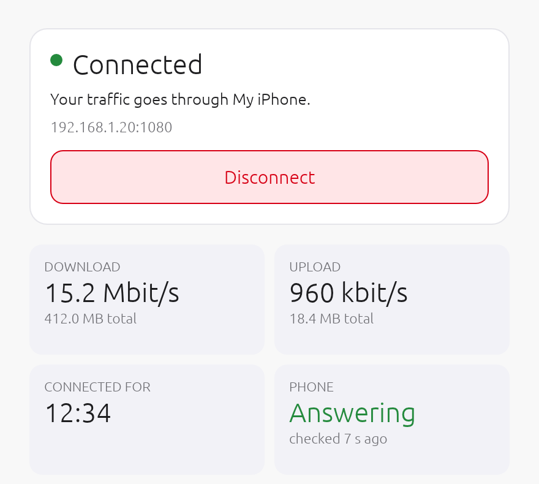
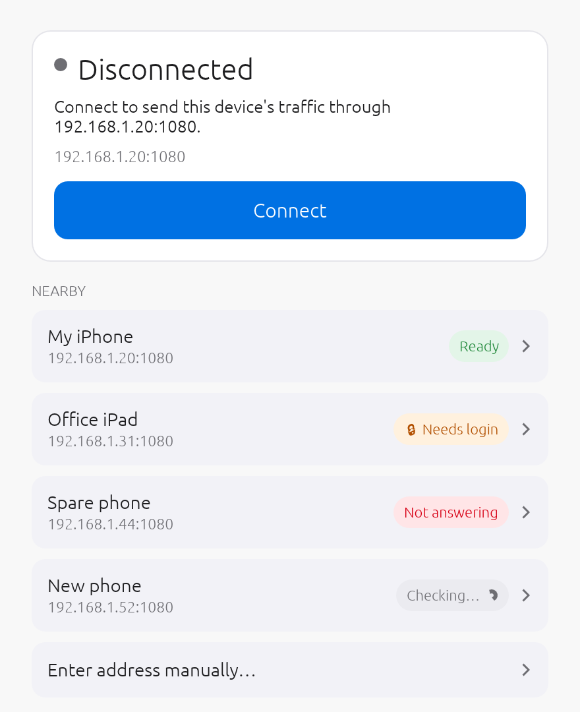

# NetBridge

**Connect your router, Windows PC, Mac, Apple TV and iPad to NetBridge on your iPhone.** Tap once on the iPhone, then pick it from the **Nearby** list on the other device. No accounts, no setup files.

| Platform | Get it |
|---|---|
| 📱 **iPhone** (start here) | [TestFlight]({{TESTFLIGHT_IPHONE}}) |
| 📶 **Router** (OpenWrt, GL.iNet) | Installed from the iPhone app, see [Router](#router-openwrt-and-glinet) |
| 🪟 **Windows** 10/11 | [x64](https://github.com/Korporate1k/NetBridge/releases/latest/download/NetBridge-win-x64.zip) · [ARM64](https://github.com/Korporate1k/NetBridge/releases/latest/download/NetBridge-win-arm64.zip) · [all releases](https://github.com/Korporate1k/NetBridge/releases) |
| 💻 **Mac** (macOS 14+) | [TestFlight]({{TESTFLIGHT_MAC}}) |
| 📺 **Apple TV** (tvOS 17+) | [TestFlight]({{TESTFLIGHT_TV}}) |
| 📱 **iPhone & iPad** (as a device) | Same app as above |

---

## Before you start: the iPhone

1. Install **NetBridge** from TestFlight and open it.
2. On the **Dashboard** tab, tap **Start relay**. Keep NetBridge open.
3. Put the other device on the **same Wi-Fi as the iPhone, or on its Personal Hotspot**.

The Dashboard shows the iPhone's address and port, plus a QR code, for devices that need them typed in. To make devices log in first, set **Settings → Require a password**.

---

## Router (OpenWrt and GL.iNet)

Install NetBridge on your router once from the iPhone app, then run the router from the app. Every device on the router's Wi-Fi and cable is connected, with nothing to install on those devices.

✅ **Tested on GL.iNet Beryl 7 (GL-MT3600BE) and GL.iNet Opal (GL-SFT1200).**

**Works with:** OpenWrt **18.06 through 24.10**, including GL.iNet firmware. ARM, MIPS and x86 routers.
- OpenWrt 22.03 and later need the firewall component. The app installs it for you (**Install the firewall component**).
- OpenWrt 25.12 and later aren't supported yet.

### Install (from the iPhone, about two minutes)
1. Join the iPhone to the **router's Wi-Fi** (or cable).
2. In NetBridge, open the **Router** tab and tap **Install on a new router**.
3. Enter the **router address** (GL.iNet: `192.168.8.1`) and its **admin password**, the one for the router's web page.
4. Tap **Install NetBridge on this router**. The app shows each step and finishes with **Done**.
5. Tap **Use this iPhone**. Every device on the router now goes through this iPhone.

The admin password is used for the install only. It is not saved unless you turn on **Remember on this iPhone**. When a newer router package ships with the app, the Router tab offers **Update the router**.

### Control the router from the app
The **Router** tab is a full remote for the router:

| In the app | What you can do |
|---|---|
| **Use this iPhone** · **Use another phone…** · **Pause** / **Resume** | Choose which phone the router uses, or pause NetBridge on the router |
| Live traffic | A live graph of the router's traffic |
| **Devices**: who's on the router | See every device. **Bypass** one so it uses the router's own internet, **Rename** it, or **Block** it |
| **Wi-Fi**: network names and passwords | Turn networks on or off and change their name, password, security, or hide them (main, guest, IoT) |
| **Internet**: how the router gets online | See the current connection, scan for nearby networks, join, or switch to a saved one |
| **NetBridge settings**: phone address, login, DNS | How the phone is connected, what happens when it stops answering, DNS, devices that should never go through the phone |
| **System**: health, lights, reboot | Temperature, memory, storage, uptime, the LEDs, and **Reboot router…** |
| **VPN & extras** (GL.iNet) | The VPN client, AdGuard Home, and **Check for updates** for the firmware |
| **Diagnostics** | **Test the phone** and a speed test |
| **Router package** | See the router's version and **Update router** |

On the router's own web page (LuCI 19.07 and later), **Services → NetBridge** has the same settings plus **Connection checks**, a one-click checklist with a fix for anything that fails.

### If something's off
- **Phone not answering**: open NetBridge on the phone, keep it in front, then try again.
- **Login rejected**: tap **Fix login** on the Router tab.
- **NetBridge can't start here**: tap **Install the firewall component**.

---

## Windows

**Every app on the PC**, games and calls included (TCP and UDP), goes through your iPhone. Windows 10 or 11, 64-bit.

### Download
- **[NetBridge-win-x64.zip](https://github.com/Korporate1k/NetBridge/releases/latest/download/NetBridge-win-x64.zip)** for most PCs (Intel/AMD)
- **[NetBridge-win-arm64.zip](https://github.com/Korporate1k/NetBridge/releases/latest/download/NetBridge-win-arm64.zip)** for ARM PCs (Snapdragon)

### First launch
1. Optional: right-click the zip → **Properties** → tick **Unblock** → OK.
2. **Extract the whole folder.** Keep `NetBridge.exe` next to `wintun.dll`.
3. If Windows shows **"Windows protected your PC"**, click **More info → Run anyway**. NetBridge isn't code-signed yet, so Windows doesn't recognise it.
4. The admin prompt says **Unknown publisher**: click **Yes**. NetBridge needs administrator rights to create its network adapter.
5. Optional: check your download. In PowerShell, `Get-FileHash NetBridge-win-x64.zip` must match the line in `SHA256SUMS.txt` on the [release page](https://github.com/Korporate1k/NetBridge/releases/latest).

### Connect
1. On the iPhone: **Start relay** (Dashboard tab).
2. On the PC: join the **same Wi-Fi as the iPhone, or its Personal Hotspot**.
3. Open NetBridge and click the iPhone under **Nearby**. Enter the login if it asks.
4. Not listed? Use **Enter address manually…** with the address and port shown on the iPhone.

Closing the window keeps NetBridge connected in the notification area. Right-click its icon to **Disconnect**, **Show NetBridge** or **Quit**. If the connection drops, NetBridge tries again by itself.

| Status | Meaning |
|---|---|
| **Connected** | Your traffic goes through the iPhone |
| **Phone not answering** | Open NetBridge on the phone, then try again |
| **Login rejected** | Fix the username or password and connect again |
| **Reconnecting** | The connection dropped; NetBridge is trying again |

---

## Mac

1. Open NetBridge for Mac on the same Wi-Fi as the iPhone, or on its Personal Hotspot.
2. Click the iPhone under **Nearby**. Enter the login if it asks.
3. Allow the VPN configuration the first time macOS asks.

NetBridge stays in the menu bar when you close its window. **Settings → Open at Login** starts it with your Mac.

## Apple TV

1. Open NetBridge on the Apple TV, on the same Wi-Fi as the iPhone, or on its Personal Hotspot.
2. Select the iPhone under **Nearby**.
3. Allow the VPN configuration the first time tvOS asks.

## iPhone & iPad (as a device)

1. Open NetBridge on the other iPhone or iPad, on the same Wi-Fi as the main iPhone, or on its Personal Hotspot.
2. Open the **Connect** tab and tap the iPhone under **Nearby**.
3. Allow the VPN configuration the first time iOS asks.

Tap **Disconnect** on the Connect tab to stop.

---

## Privacy
NetBridge collects nothing: no accounts, no advertising, no analytics, no tracking. Everything stays between your devices and your iPhone.
